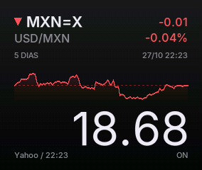

# USD/MXN Monitor

A desktop **USD → MXN** exchange rate monitor for the **Waveshare ESP32-C6-Touch-LCD-1.83**, with an interface inspired by the macOS stock widget. It displays the value of one US dollar in Mexican pesos, a five-session chart, and battery status. It connects directly to Wi-Fi without a separate server or companion app.

**Git release: `v0.2.0`** · Arduino / C++ · Automatic rotation in four orientations

## Screenshot



Actual capture from the renderer running on the board with version 0.2.0, retrieved over USB at **284 × 240 pixels**. The price reflects the time of capture. The battery bar is hidden because the device was connected to USB with a full battery.

## Features

- Yahoo Finance market quotes, refreshed automatically every five minutes.
- Chart of the last five trading sessions with hourly samples, absolute change in pesos, and percentage change.
- Responsive layout: **240 × 284** in portrait and **284 × 240** in landscape, including both inverted orientations.
- Manual refresh using PWR or a strong shake, with on-screen feedback.
- Three brightness modes: `ON`, `AUTO`, and `DIM`, preserved across restarts.
- Battery bar with a blue charging animation and a red low-battery indicator.
- Last known quote retained during connection failures and restored after restart.
- HTTPS certificate validation and timekeeping backed by the board's RTC.

## Hardware

Designed and tested on the **Waveshare ESP32-C6-Touch-LCD-1.83**. No external sensor wiring is required.

| Component | Specification and use |
| --- | --- |
| Microcontroller | ESP32-C6, 32-bit RISC-V, up to 160 MHz |
| Memory | 512 KB SRAM and 16 MB flash on this board |
| Display | 1.83-inch touch LCD, 240 × 284, ST7789P controller over SPI; RGB565 rendering |
| Touch | CST816D over I²C; wakes the display |
| Motion | QMI8658 six-axis IMU; accelerometer used for rotation and shake detection |
| Power management | AXP2101; battery percentage, USB connection, and charging status |
| Clock | Battery-backed PCF85063; maintains time for HTTPS connections |
| Connectivity used | 2.4 GHz Wi-Fi |
| USB | USB-C for power, flashing, diagnostics, and screenshots |
| Controls | PWR and BOOT buttons; the app uses PWR |
| Battery in the tested unit | 602525 LiPo, 3.7 V, 400 mAh, included in the kit used for this project |

The board also includes audio hardware and a microSD slot, which this app does not use. Reference specifications: [official Waveshare documentation](https://docs.waveshare.com/ESP32-C6-Touch-LCD-1.83) and [manufacturer examples](https://github.com/waveshareteam/ESP32-C6-Touch-LCD-1.83).

Battery percentage is read from the AXP2101 using `getBatteryPercent()`. Calibration may require a charge/discharge cycle. The firmware preserves the existing charging current and voltage settings.

### Internal connections used

| Signal | GPIO |
| --- | --- |
| LCD SCK / MOSI | 1 / 2 |
| LCD DC / CS / RESET | 3 / 5 / 4 |
| Backlight | 6 |
| I²C SDA / SCL | 7 / 8 |
| Touch interrupt | 11 |

PWR is read through the AXP2101 power management chip rather than directly through a GPIO.

## Controls and display modes

| Action | Result |
| --- | --- |
| Single short PWR press | Requests a quote and wakes the display |
| Two quick PWR presses | Cycles through `ON → AUTO → DIM → ON` |
| Strong shake | Requests a quote and wakes the display |
| Tap while the display is off | Wakes the display without fetching data |
| Tap while the display is on or dimmed | No action |
| Rotate the device | Adjusts orientation without fetching data or waking the display |

The double-press window is **450 ms**; a single press waits for that window before taking effect. Manual requests have a minimum interval of **15 seconds**. The current on-device interface uses Spanish status messages: `Actualizando...` (Updating...), `Actualizado` (Updated), and `Sin cambios` (No changes).

| Mode | Behavior |
| --- | --- |
| `ON` | Display stays on at normal brightness |
| `AUTO` | Dims after 30 seconds of inactivity and turns off after 60 seconds |
| `DIM` | Display stays on at minimum brightness, PWM 1 out of 255 |

In `DIM`, refreshing or pressing PWR once preserves minimum brightness. Turning off the display in `AUTO` does not put the microcontroller to sleep: data fetching, touch sensing, and motion detection remain active.

Rotation requires a stable position for approximately **700 ms**, in addition to sensor filtering. When lying flat on a table, held diagonally, or being shaken, the device keeps its previous orientation.

### Battery indicator

The length of the top bar represents the remaining battery percentage:

| State | Appearance |
| --- | --- |
| Actively charging | Blue, with a highlight sweeping across the filled portion from left to right every 2.4 seconds |
| Not charging, above 20% | Green |
| Not charging, 20% or below | Red |
| USB connected, battery at 100% | Bar and background completely hidden |
| No valid reading | Gray pattern |

Status is checked every second. USB connection is detected separately from active charging: a full battery can remain connected without charging.

## Quotes and connectivity

The large price shows how many Mexican pesos **1 USD** is worth. The chart covers five **trading sessions**, omitting periods without trading. The change is measured against the first chart sample, marked by the dotted line; it does not necessarily represent the daily change.

- The date beside `5 DIAS` (5 DAYS) is the quote timestamp in Mexico City time.
- `Yahoo / HH:MM` shows the last successful fetch; fetching does not guarantee that the provider has published a new price.
- On failure, previous data remains visible and an error appears in amber. The app retries after one minute, or after five minutes if the server returns HTTP 429.

The app uses the public [Yahoo Finance USD/MXN](https://finance.yahoo.com/quote/MXN%3DX/) chart endpoint:

```text
https://query1.finance.yahoo.com/v8/finance/chart/MXN=X?range=5d&interval=60m
```

It currently requires no account or API key. Availability is not guaranteed, and the endpoint may change or rate-limit requests. Quotes may differ slightly from Google and do not represent a bank's buy or sell rate. The app does not silently substitute a daily exchange rate.

HTTPS certificates are validated using DigiCert Global Root G2. The PCF85063 preserves time, initially seeded from the build computer's clock and then adjusted using the `Date` header from an authenticated HTTPS response. NTP is also requested in the background. If the RTC loses all power and the firmware is old, rebuilding and flashing may be necessary to restore the time. Response sizes are bounded, and the symbol, currency, values, and timestamps are validated before updating the display.

## Build and flash

Requirements: Arduino CLI, Python 3, a USB-C data cable, and a 2.4 GHz Wi-Fi network. Tests and desktop previews also require a C++17 compiler.

Before installing dependencies, update the absolute paths in `arduino-cli.yaml` to match your project directory. Tools and libraries are stored under `.arduino/`, leaving the global installation unchanged.

Pinned versions: ESP32 Arduino 3.3.4, GFX Library for Arduino 1.6.3, SensorLib 0.3.3, XPowersLib 0.3.0, and ArduinoJson 7.4.2. The Inter font's OFL license is included in `assets/fonts/OFL.txt`.

```sh
arduino-cli --config-file arduino-cli.yaml core update-index
arduino-cli --config-file arduino-cli.yaml core install esp32:esp32@3.3.4
arduino-cli --config-file arduino-cli.yaml lib install 'GFX Library for Arduino@1.6.3' 'SensorLib@0.3.3' 'XPowersLib@0.3.0' 'ArduinoJson@7.4.2'
```

In a fresh clone, copy `wifi.example.json` to `wifi.local.json` and fill in `ssid` and `password`. **2.4 GHz** Wi-Fi is required. The local file, generated `secrets.h` header, and binaries are excluded from Git. Firmware binaries contain credentials and should not be shared.

```sh
cp wifi.example.json wifi.local.json
# Edit wifi.local.json with your credentials before building.
sh tools/build.sh
arduino-cli --config-file arduino-cli.yaml board list
sh tools/upload.sh /dev/cu.usbmodem101
```

The port may change when reconnecting. `upload.sh` rebuilds and flashes only after a successful build. The build configuration uses USB CDC, 16 MB flash, and the `app3M_fat9M_16MB` partition scheme.

On the Apple Silicon Mac used for development, Arduino's `ctags` helper had to be compiled natively because the supplied binary was Intel-only and Rosetta was unavailable. If reinstalling the tools causes a `bad CPU type in executable` error, run `sh tools/native_ctags.sh`. The script uses the same official 5.8-arduino11 release, verifies its SHA-256, and adapts a legacy identifier that conflicts with the current macOS SDK.

## Project structure

| Path | Contents |
| --- | --- |
| `UsdMxnMonitor/UsdMxnMonitor.ino` | Hardware initialization, networking, controls, and main loop |
| `UsdMxnMonitor/Widget.h` | Interface and responsive layout |
| `UsdMxnMonitor/DisplayRotation.h` | Rotation of image strips |
| `UsdMxnMonitor/Model.h` | Data, timers, and button, shake, and orientation detection |
| `UsdMxnMonitor/QuoteParser.h` | Yahoo response validation and parsing |
| `tools/` | Build, flash, configuration, capture, and preview utilities |
| `tests/` | Logic and rotation tests, plus a sample response |
| `reference/waveshare/` | Manufacturer examples used as references |
| `assets/fonts/` | Inter font and its OFL license |
| `docs/images/` | Screenshots used in this README |
| [VALIDATION.md](VALIDATION.md) | Test results and on-device verification log (in Spanish) |

## Tests and previews

After installing dependencies:

```sh
sh tests/run.sh
```

Tests cover invalid or incomplete responses, timestamps, historical data, timers, controls, shakes, and stable orientation detection. They also check every pixel's position in all four rotations. The script generates PPM previews in `build/` using the same renderer as the firmware.

To generate another preview after running the tests:

```sh
build/preview tests/fixtures/yahoo_5d.json build/portrait.ppm preview
build/preview tests/fixtures/yahoo_5d.json build/landscape.ppm preview --landscape
```

The `busy`, `offline`, `empty`, `charging`, `plugged-full`, and `unplugged-full` states are also supported.

Rendering uses strips of 20 rows, up to 11.36 KB each, plus another strip for software rotation. The ST7789 stays in its native addressing mode to avoid image offsets caused by RAM outside the visible area. Networking runs in a separate task; only the main task accesses I²C and the display.

## USB diagnostics and screenshots

Serial communication runs at **115200 baud**:

| Command | Action |
| --- | --- |
| `d` | Hardware, power, mode, Wi-Fi, and memory diagnostics, without credentials |
| `a` | Current acceleration and orientation |
| `r` | Request a refresh |
| `m` | Change display mode |
| `s` | Capture the logical interface image in RGB565 |

```sh
python3 tools/serial.py /dev/cu.usbmodem101 --seconds 15 --send d
python3 tools/serial.py /dev/cu.usbmodem101 --seconds 10 --capture build/screen.rgb565
```

A capture produces `screen.rgb565` and `screen.json`, using RGB565LE and the current orientation's dimensions. To view it, convert the raw pixels into an image format such as PNG. Do not open two serial monitors on the same port simultaneously.

## Releases

- **`v0.2.0`**: responsive layout and automatic rotation in four orientations, calibrated and verified on the board.
- **`v0.1.0`**: first tagged release, including quotes, chart, controls, brightness modes, and an animated charging bar that hides when the battery is full and USB is connected.

Historical `v1.x` serial messages identify development iterations; published project versions use the Git tags listed above.

The Inter font includes its [SIL Open Font License](assets/fonts/OFL.txt).
